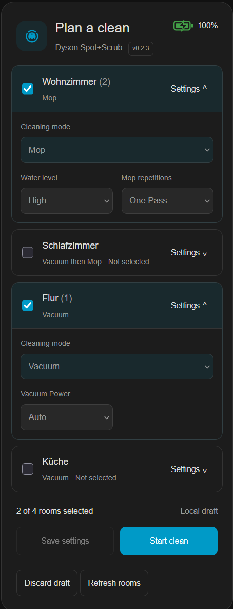
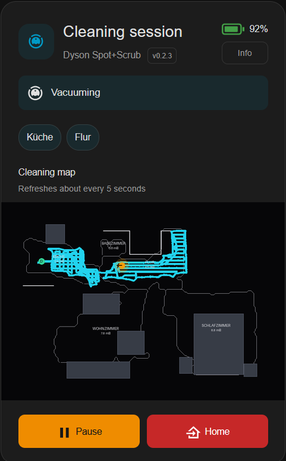

# Dyson Cleaning Planner Card

A Home Assistant dashboard card for planning room cleaning and keeping an eye on your Dyson Spot+Scrub AI.

**Version 1.0.0**

## Requirements

- [Dyson Spot+Scrub integration by UNsync3D](https://github.com/UNsync3D/ha-dyson-spot-scrub), **v1.5.0 or newer**, installed and configured in Home Assistant.
- [HACS](https://www.hacs.xyz/) for the recommended installation method. Manual installation is also supported.

## Screenshots

<table>
  <tr>
    <td align="center">
      
      <br>Plan a clean
    </td>
    <td align="center">
      
      <br>Follow the cleaning session
    </td>
  </tr>
</table>

[Try the interactive preview](https://futurazor.github.io/dyson-cleaning-planner-card/preview/index.html). It uses simulated data; no robot is connected.

## Installation

### HACS (recommended)

1. Open **HACS** in Home Assistant.
2. Open the **⋮ menu → Custom repositories**.
3. Enter `https://github.com/FutuRazor/dyson-cleaning-planner-card`, select **Dashboard** as the type, and click **Add**.
4. Find **Dyson Cleaning Planner Card** in HACS, open it, and download it.
5. Reload your Home Assistant page.

If the repository is already listed in HACS, you can find and download it directly. See [HACS custom repository instructions](https://www.hacs.xyz/docs/faq/custom_repositories/) if needed.

### Manual installation

1. Download **dyson-cleaning-planner-card.js** from the [latest release](https://github.com/FutuRazor/dyson-cleaning-planner-card/releases/latest).
2. Copy **only this JavaScript file** into:

   ```text
   /config/www/dyson-planner/dyson-cleaning-planner-card.js
   ```

   Create the `www` and `dyson-planner` folders if needed. Do not copy the whole `dist` folder. When accessing the configuration folder from Windows, the relative path is `www\dyson-planner\dyson-cleaning-planner-card.js`.

3. Go to **Settings → Dashboards → ⋮ → Resources → Add resource**:
   - **URL:** `/local/dyson-planner/dyson-cleaning-planner-card.js`
   - **Resource type:** JavaScript module
4. If you created the `www` folder for the first time, restart Home Assistant. Reload the dashboard afterward.

If **Resources** is not visible, enable **Advanced mode** in your Home Assistant user profile.

### Add the card to your dashboard

Open your dashboard and choose **Edit dashboard → Add card**. Search for **Dyson Cleaning Planner**, select your Dyson vacuum, and save. Rooms and supported controls are detected automatically.

The visual editor handles the usual setup; no YAML is required.

<details>
<summary>If the card does not appear after a HACS installation</summary>

Reload the page first. If the card is still missing, check **Settings → Dashboards → ⋮ → Resources** for this JavaScript module:

```text
/hacsfiles/dyson-cleaning-planner-card/dyson-cleaning-planner-card.js
```

Add it only if it is missing. If you manage dashboard resources in YAML, register that URL in your `lovelace.resources` configuration instead.

</details>

### Updates

Update through HACS, or replace the same JavaScript file for a manual installation. Reload the page; if the old version remains, use **Ctrl+F5** on a desktop browser or clear the frontend cache in your browser/app. You do not normally need to change the resource URL.

## Using the card

### Plan a clean

Select rooms and adjust **Cleaning mode**, **Vacuum Power**, **Water level**, and **Clean repetitions**. Changes stay in a local draft until you choose:

- **Save settings** — save changed room settings without starting a cleaning session.
- **Start clean** — start the selected rooms with your chosen settings.

The trash icon beside **Local draft** discards unsaved changes. Reloading the card also clears the draft. The robot may clean rooms in a different order from your selection.

### During and after cleaning

The card switches to a cleaning view with robot status, room badges when known, and an optional live map. Use **Pause**, **Resume**, or **Home** as available.

Dock activity appears below the header, including dust-bin emptying, roller washing and drying. Drying shows the remaining time and a progress bar when available, with a button to cancel it. New cleaning starts follow the integration's readiness checks; starting during drying is allowed.

### Station settings and consumables

The **Info** button opens two tabs:

- **Station settings:** hot-water options, cleaning solution, extended roller preparation, self-cleaning frequency and drying duration, plus **Empty dust bin** and **Wash mop roller**.
- **Consumables:** remaining life for the brush bar, mop roller, side brushes and filters, plus cleaning-solution availability and whether its use is enabled.

**Station settings take effect immediately** and are separate from the room draft. Consumable bars change from the theme accent to orange and red as their remaining life decreases. The Info button highlights red when a consumable needs attention.

## Customization

Open **Edit dashboard**, then edit the card to change its title, room visibility and display order, optional map and map rotation. You can also choose whether unavailable settings are hidden or disabled, and whether settings irrelevant to the selected cleaning mode remain visible.

Where Home Assistant offers the **Layout** tab, height is automatic by default. A fixed height enables scrolling inside the card. Room edits preserve your scroll position; switching between planner and cleaning views starts at the top.

<details>
<summary>Advanced YAML options</summary>

These options belong in the individual card's code editor, not in `configuration.yaml`.

| Option | Description |
|---|---|
| `entity` | Required Dyson vacuum entity |
| `title` | Planner title; default: `Plan a clean` |
| `always_show_all_settings` | Keep all room settings visible; default: `false` |
| `unsupported_settings` | `disabled` (default) or `hidden` |
| `excluded_rooms` | Room switch entity IDs to hide |
| `room_order` | Room switch entity IDs in display order |
| `room_entities` | Optional mapping from room names to switch entity IDs |
| `show_camera` | Show the map during cleaning; default: `true` |
| `camera_entity` | Optional camera entity on the same Dyson device |
| `camera_rotation` | `0`, `90`, `180`, or `270` degrees |

</details>

## Limitations and troubleshooting

- The card relies on the integration for room data, robot status and supported actions. It does not guarantee cleaning order or report confirmed progress for each room.
- After changes to the robot's map, use **Refresh rooms** below the room order in the card editor if needed.
- If controls are unavailable, check the corresponding device and entities in Home Assistant and confirm that the required integration version is installed.


## License

[MIT](LICENSE) · Copyright (c) 2026 FutuRazor.
