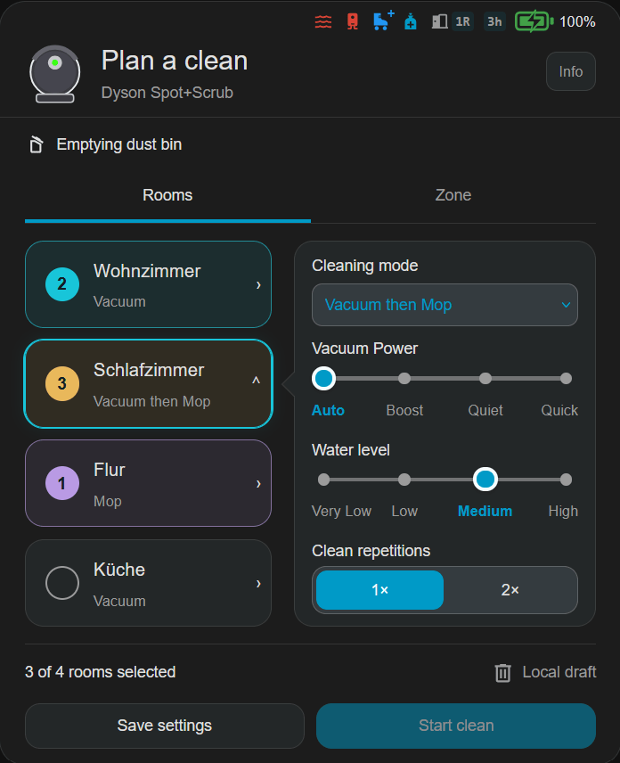
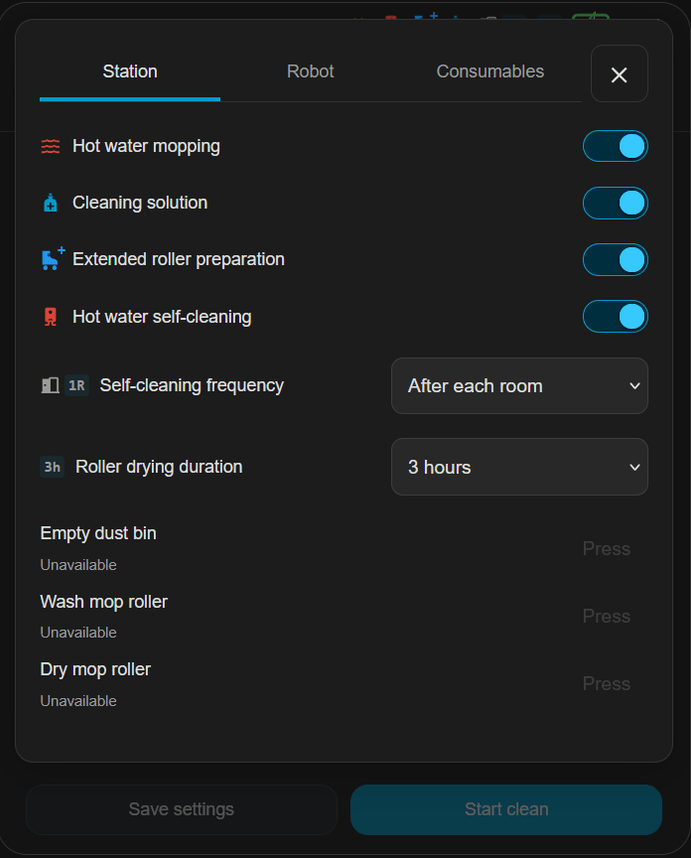
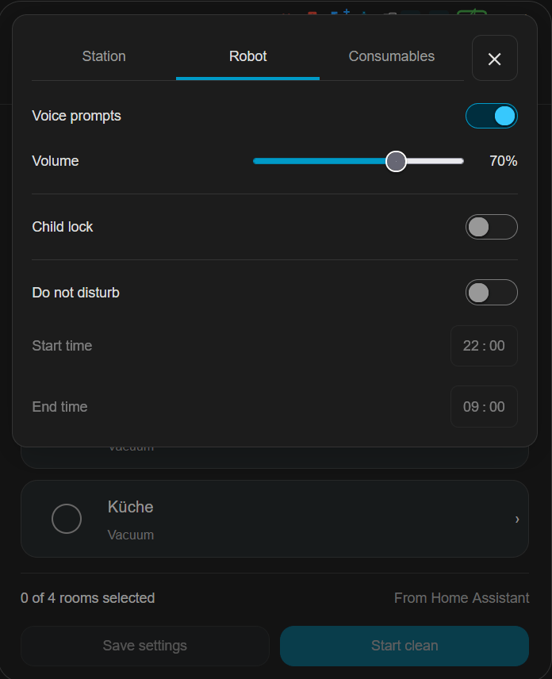
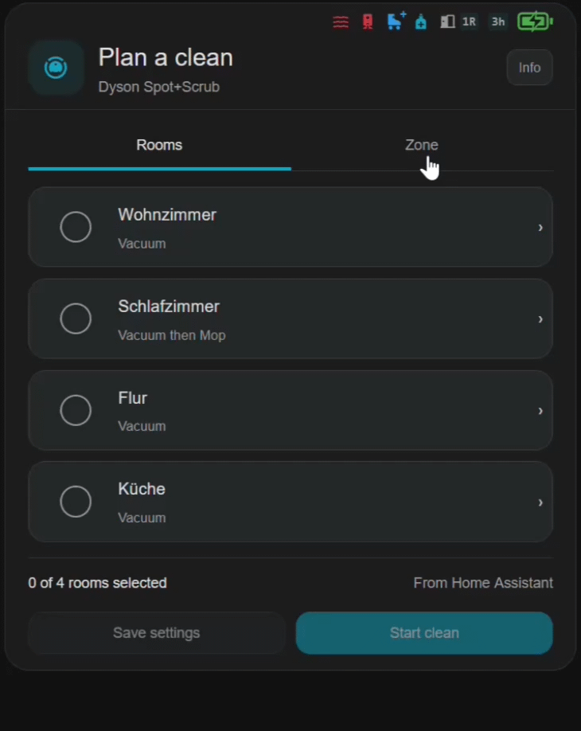

<p align="center">
  
</p>

<p align="center">
  <a href="https://my.home-assistant.io/redirect/marketplace_repository/?owner=FutuRazor&amp;repository=dyson-cleaning-planner-card&amp;category=plugin">
    
  </a>
</p>

<p align="center">
  <a href="https://github.com/FutuRazor/dyson-cleaning-planner-card/releases/latest"></a>
  <a href="https://github.com/FutuRazor/dyson-cleaning-planner-card/actions/workflows/validate.yml"></a>
  <a href="https://futurazor.github.io/dyson-cleaning-planner-card/preview/index.html"></a>
</p>

<p align="center">
  Plan room or zone cleaning, adjust cleaning settings, and follow your Dyson's progress in Home Assistant.
</p>

**Version 1.4.0**

<p align="center">
  <a href="#installation">Installation</a> &middot;
  <a href="#using-the-card">Using the card</a> &middot;
  <a href="#customization">Customization</a> &middot;
  <a href="#limitations-and-troubleshooting">Troubleshooting</a>
</p>

## Requirements

- [Dyson Spot+Scrub integration by UNsync3D](https://github.com/UNsync3D/ha-dyson-spot-scrub), **v2.1.0 or newer**, installed and configured in Home Assistant.

This experimental branch also provides a [hass-dyson adapter for Spot+Scrub](docs/hass-dyson.md): rooms/settings, room starts, session controls, battery, consumables and the combined vacuum/mop coverage image. Select **Integration → hass-dyson (experimental)** in the editor. Automatic initial discovery prefers the existing Spot+Scrub integration; an explicitly selected robot remains authoritative. Rectangle cleaning and station/robot preferences remain exclusive to the existing adapter. Live acceptance of the new adapter is still required.
- **Home Assistant Marketplace** for the recommended installation method on Home Assistant **2026.11 or newer**. On older versions, use [HACS](https://www.hacs.xyz/). Manual installation is also supported.

For integration developers, the [complete integration contract](docs/integration-contract.md) documents required and optional entities, registry identities, attributes, action payloads and validation. 

## Screenshots

<p align="center">
  
  <br>Modern planner — wide layout
</p>

<table>
  <tr>
    <td align="center"><br>Cleaning session</td>
    <td align="center"><br>Consumables</td>
  </tr>
  <tr>
    <td align="center"><br>Station settings</td>
    <td align="center"><br>Consumables</td>
  </tr>
    <tr>
    <td align="center"><br>Zone Cleaning</td>
    <td align="center"><br>Zone Cleaning Video</td>
  </tr>
</table>


[Try the interactive preview](https://futurazor.github.io/dyson-cleaning-planner-card/preview/index.html). It uses simulated data; no robot is connected.

## Installation

### Marketplace (recommended — Home Assistant 2026.11 or newer)

1. Open **Settings → Marketplace**.
2. Select **Add from link** in the upper-right corner.
3. Enter `https://github.com/FutuRazor/dyson-cleaning-planner-card` and select **Add**. If asked for the content type, choose **Dashboard**. Connect your GitHub account if prompted.
4. Open **Dyson Cleaning Planner Card** and select **Install**.
5. Reload your Home Assistant page, then add the card to your dashboard as described below.

You can install through **Add from link** even before the card is listed in the public catalog. If it is already listed, find and install it directly. See the [Marketplace instructions](https://www.home-assistant.io/integrations/marketplace) for details.

### HACS (Home Assistant versions before 2026.11)

1. Open **HACS** in Home Assistant.
2. Open the **⋮ menu → Custom repositories**.
3. Enter `https://github.com/FutuRazor/dyson-cleaning-planner-card`, select **Dashboard** as the type, and click **Add**.
4. Find **Dyson Cleaning Planner Card** in HACS, open it, and download it.
5. Reload your Home Assistant page.

If the repository is already listed in HACS, you can find and download it directly. See [HACS custom repository instructions](https://www.hacs.xyz/docs/faq/custom_repositories/) if needed.

### Manual installation

1. Download **dyson-cleaning-planner-card.js** from the [latest release](https://github.com/FutuRazor/dyson-cleaning-planner-card/releases/latest).
2. Copy **only this JavaScript file** into:

   ```text
   /config/www/dyson-planner/dyson-cleaning-planner-card.js
   ```

   Create the `www` and `dyson-planner` folders if needed. Do not copy the whole `dist` folder. When accessing the configuration folder from Windows, the relative path is `www\dyson-planner\dyson-cleaning-planner-card.js`.

3. Go to **Settings → Dashboards → ⋮ → Resources → Add resource**:
   - **URL:** `/local/dyson-planner/dyson-cleaning-planner-card.js`
   - **Resource type:** JavaScript module
4. If you created the `www` folder for the first time, restart Home Assistant. Reload the dashboard afterward.

If **Resources** is not visible, enable **Advanced mode** in your Home Assistant user profile.

### Add the card to your dashboard

Open your dashboard and choose **Edit dashboard → Add card**. Search for **Dyson Cleaning Planner**, select your Dyson vacuum, and save. Rooms and supported controls are detected automatically.

The visual editor handles the usual setup; no YAML is required.

<details>
<summary>If the card does not appear after a Marketplace or HACS installation</summary>

Reload the page first. Marketplace normally registers the dashboard resource automatically. If the card is still missing, check **Settings → Dashboards → ⋮ → Resources** for its JavaScript module:

```text
/local/community/dyson-cleaning-planner-card/dyson-cleaning-planner-card.js
```

An existing HACS installation may use `/hacsfiles/dyson-cleaning-planner-card/dyson-cleaning-planner-card.js`; that path continues to work after migration. Keep any version parameter already present in the URL. Do not add a second resource if either path is already registered.

Add the resource only if it is missing. If you manage dashboard resources in YAML, follow the installation dialog's instructions and register it in your `lovelace.resources` configuration instead.

</details>

### Updates

Update through Marketplace (or HACS on older Home Assistant versions), or replace the same JavaScript file for a manual installation. Reload the page; if the old version remains, use **Ctrl+F5** on a desktop browser or clear the frontend cache in your browser/app. You do not normally need to change the resource URL.

## Using the card

### Plan rooms

In **Modern**, tap the circle to select a room; its number shows the selection order. Tap the room name, mode or arrow to open its settings without changing the selection. **Classic** remains available in the editor.

Adjust **Cleaning mode**, **Vacuum Power**, **Water level**, and **Clean repetitions**. Power and water sliders snap to the options supplied by the integration. Settings irrelevant to the current mode are hidden by default; repetitions remain available in every mode.

Changes stay in a local draft until you choose:

- **Save settings** — save changed room settings without starting a cleaning session.
- **Start clean** — start the selected rooms with your chosen settings.

The trash icon beside **Local draft** discards unsaved changes. Reloading the card also clears the draft. Selected room IDs are sent in click order; the integration and robot execute the request. The display order configured in the editor is separate from this selection order.

### Clean a zone

Choose **Zone** below the header to clean a specific area instead of whole rooms. A blue rectangle appears on the map: drag it to move it and use the corner handle to resize it. The circular resize handle stays anchored to the corner and has an enlarged touch target. A floating badge shows the dimensions without covering small zones. The card limits the selection to a minimum of **55 × 55 cm**. Whether the selected area can be reached and cleaned depends on the robot and any obstacles.

The button beside Reload shows the current cleaning mode. Open it to choose **Vacuum**, **Vacuum and Mop**, **Mop**, or **Vacuum then Mop**, plus the relevant power, water level and repetitions. Settings stay local until **Start clean**. With **Vacuum then Mop**, **Mop repetitions** controls the wiping passes; vacuuming runs once.

Switching between **Rooms** and **Zone** keeps your local plans. Reload fetches a fresh map and preserves the rectangle when the map and its coordinates are unchanged. Map rotation also applies to zone selection. One rectangular zone is supported at a time; zone cleaning has been hardware-tested on the Spot+Scrub AI, while other models still need confirmation.

Zone dimensions follow Home Assistant's unit system by default, using **cm** or whole **inches**. In the editor, choose **Automatic**, **cm**, **inch**, or **Off**. Off hides only the selection badge; dimensions shown during a cleaning session still use Home Assistant's units.

### During and after cleaning

The card switches to a cleaning view with robot status, an optional live map, and room badges when known. A zone started from this card shows its dimensions instead. Use **Pause**, **Resume**, or **Home** as available.

Status below the header shows cleaning and dock activity, including dust-bin emptying, mop washing and drying. Drying includes the remaining time, a progress bar and a cancel button when available. In Modern, this area stays in place without changing the card height and shows **Docked** when idle at the station.

Modern displays temporary notices and robot errors over the header. Dismissed errors remain accessible through the warning on the robot icon. New cleaning starts follow the integration's readiness checks, including during drying or when a reported error no longer blocks a start.

### Station, robot settings and consumables

The **Info** button opens three tabs:

- **Station:** hot-water options, cleaning solution, extended roller preparation, self-cleaning frequency and drying duration, plus **Empty dust bin**, **Wash mop roller** and **Dry mop roller**.
- **Robot:** voice prompts, volume in 10% steps, child lock, and Do Not Disturb with start/end times. Volume is disabled while voice prompts are off; DND times are disabled while DND is off.
- **Consumables:** remaining life for supported parts, including the brush bar, mop roller or pads, side brushes and filters, plus cleaning-solution availability and whether its use is enabled.

Only settings and consumables supported by the selected device and exposed by the integration are shown. This applies to room and zone settings as well as the Info tabs. Temporary unavailability or a busy robot disables existing controls rather than removing them.

**Station and Robot settings take effect immediately** and are separate from the cleaning drafts. Consumable bars change from the theme accent to orange and red as their remaining life decreases. Both the Info button and Consumables tab highlight red when a consumable needs attention. Click outside the Info or zone-settings overlay to close it.

## Customization

### Language

Choose **Automatic**, **English [en]**, **Deutsch [de]**, **Nederlands [nl]**, or **Français [fr]** in the card editor. Automatic (the default) follows the current Home Assistant user’s language and falls back to English for unsupported languages. The card and its visual editor use the selected language.

Room and device names, custom titles, and values sent to the integration stay unchanged. Leave the title empty to use the translated default; an existing explicit title such as `Plan a clean` stays as entered. Unknown integration options and external error messages remain in their original language.

Additional languages can be added through the [translation guide](docs/translations.md).

### Appearance

Choose **Modern** (default) or **Classic** in the card editor's **Theme** setting. Modern uses numbered room selections, stepped sliders for power and water level, and repetition buttons. On wider cards, settings appear beside the room list; on narrow cards, they expand beneath the room. Both themes use the same local drafts and selection order.

Open **Edit dashboard**, then edit the card to change its title, room visibility and display order, optional map and map rotation. You can also choose whether supported settings irrelevant to the selected cleaning mode remain visible. Unsupported settings are always hidden.

The header subtitle identifies the selected vacuum. **Header icon style** offers the default **Integration** robot illustration or the original **Home Assistant** icon. The illustration shows a dock when docked and a green beam during cleaning. Its bumper matches the live map's robot colour while cleaning, pulses in the Pause button colour when paused, and pulses red for an error. Otherwise, it uses neutral grey. Reduced-motion preferences disable pulsing.

The **status bar** shows station preferences and battery status. Disable the entire bar or hide individual indicators in the editor. Battery percentage is optional and off by default.

Interacting with **Map camera**, map visibility or rotation in the editor opens a simulated cleaning view in that preview only. Room visibility/order and room-setting display options return it to the planner. This preview sends no cleaning commands and does not switch other dashboard cards.

Where Home Assistant offers the **Layout** tab, height is automatic by default. A fixed height enables scrolling inside the card. Room edits preserve your scroll position; switching between planner and cleaning views starts at the top.

<details>
<summary>Advanced YAML options</summary>

These options belong in the individual card's code editor, not in `configuration.yaml`.

| Option | Description |
|---|---|
| `entity` | Required Dyson vacuum entity |
| `integration` | `auto` (default), `dyson_spot_scrub`, or experimental `hass_dyson` |
| `title` | Custom planner title; empty or omitted uses the translated default |
| `language` | `auto` (default), `en`, `de`, `nl`, or `fr`; applies to this card and its editor |
| `theme` | `modern` (default) or `classic` |
| `always_show_all_settings` | Keep supported room settings visible regardless of cleaning mode; default: `false` |
| `unsupported_settings` | Legacy option; unsupported settings are now always hidden |
| `excluded_rooms` | Room entity IDs to hide: switches for Spot+Scrub, room selects for hass-dyson |
| `room_order` | Those room entity IDs in display order |
| `room_entities` | Optional mapping from room names to switch entity IDs |
| `show_camera` | Show the map during cleaning; default: `true` |
| `camera_entity` | Optional same-device camera (Spot+Scrub) or image entity (hass-dyson) |
| `header_icon_style` | `integration` (default robot illustration) or `home_assistant` (original icon) |
| `zone_dimension_unit` | Dimension pill: `auto` (HA units, default), `cm`, `inch`, or `off` |
| `camera_rotation` | `0`, `90`, `180`, or `270` degrees |
| `show_status_bar` | Show station indicators and battery; default: `true` |
| `hidden_status_items` | Indicators to hide; configure through the visual editor; default: `[]` |
| `show_battery_percentage` | Show the battery percentage beside the icon; default: `false` |

</details>

## Limitations and troubleshooting

- The card relies on the integration for room data, robot status and supported actions. Room badges and zone dimensions may show the request made from this card; they are not confirmed cleaning progress and are not retained after reloading the card.
- On upgrade, cards without an explicit `theme` use Modern. Select Classic in the editor to retain the previous layout.
- After changes to the robot's map, use **Refresh rooms** below the room order in the card editor if needed.
- Zone selection requires **Dyson integration v2.1.0 or newer** and a calibrated camera image. If the image cannot be verified, Start stays disabled. Reload the map; if the problem persists, confirm the required integration version is installed and the selected camera belongs to the same robot.
- If controls are unavailable, check the corresponding device and entities in Home Assistant and confirm that the required integration version is installed.


## License

[MIT](LICENSE) · Copyright (c) 2026 FutuRazor.

