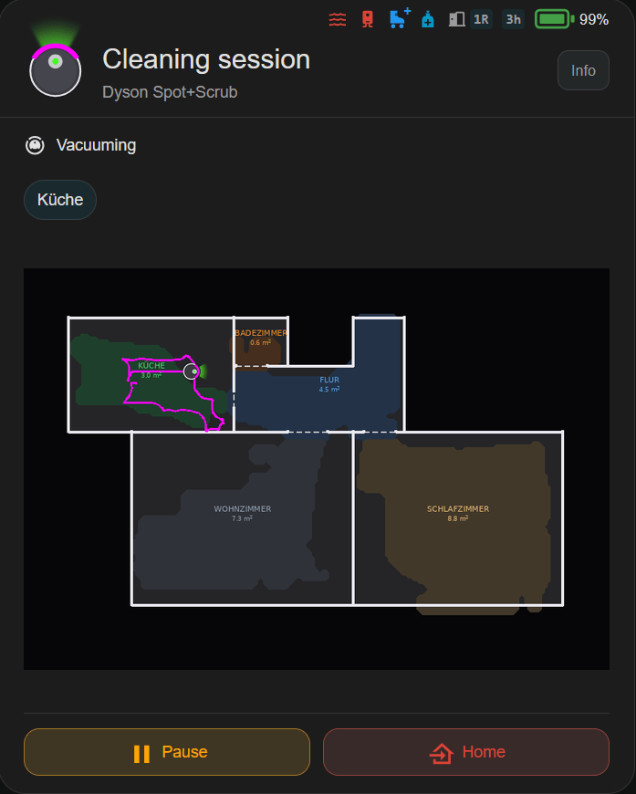
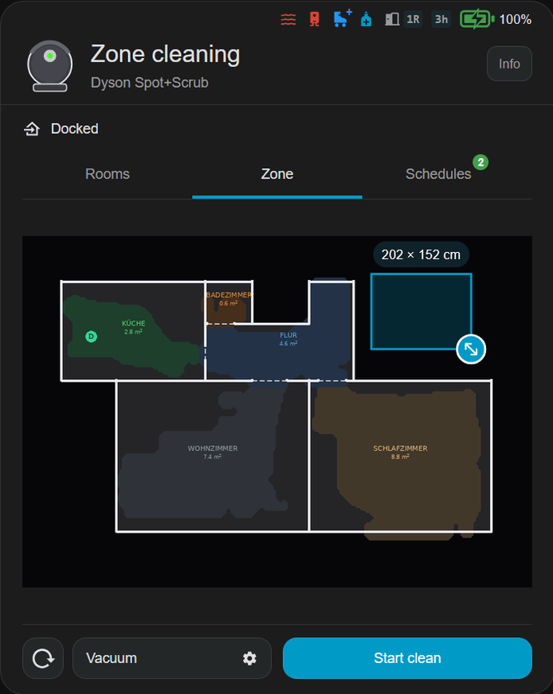
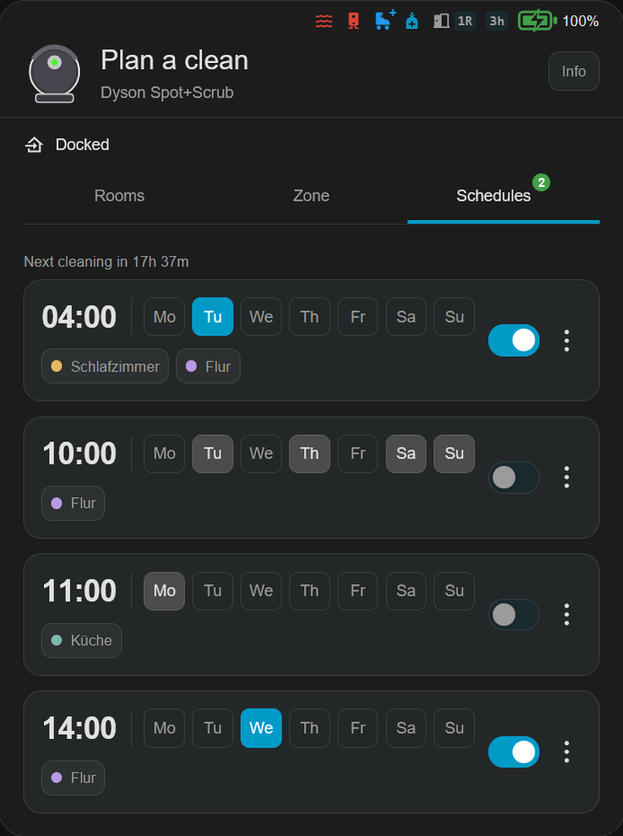
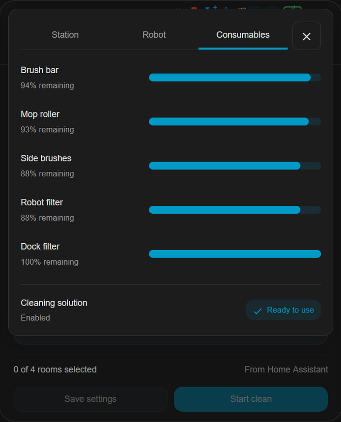

<p align="center">
  
</p>

<p align="center">
  <a href="https://my.home-assistant.io/redirect/marketplace_repository/?owner=FutuRazor&amp;repository=dyson-cleaning-planner-card&amp;category=plugin">
    
  </a>
</p>

<p align="center">
  <a href="https://github.com/FutuRazor/dyson-cleaning-planner-card/releases/latest"></a>
  <a href="https://github.com/FutuRazor/dyson-cleaning-planner-card/actions/workflows/validate.yml"></a>
  <a href="https://futurazor.github.io/dyson-cleaning-planner-card/preview/index.html"></a>
</p>

<p align="center">
  Plan room or zone cleaning, manage weekly schedules, and follow your Dyson's progress in Home Assistant.
</p>

**Version 1.7.1**

**Choose how to switch saved maps.** Use the existing header menu or wrapping map chips above the planning tabs, and hide individual maps on each card. Both use the same confirmed switching and automatic reset of the old map's local draft. Saved-map controls require the integration development branch linked below; integrations without the matching map select keep these optional controls hidden.

<p align="center">
  <a href="#installation">Installation</a> &middot;
  <a href="#using-the-card">Using the card</a> &middot;
  <a href="#robot-schedules">Schedules</a> &middot;
  <a href="#customization">Customization</a> &middot;
  <a href="#limitations-and-troubleshooting">Troubleshooting</a>
</p>

## Requirements

- A supported integration installed and configured in Home Assistant: [Dyson Spot+Scrub by UNsync3D](https://github.com/UNsync3D/ha-dyson-spot-scrub), **v2.1.0 or newer**, [hass-dyson](https://github.com/cmgrayb/hass-dyson) with the experimental Spot+Scrub adapter described below, or an entity supporting Home Assistant area cleaning for the basic room-selection adapter.
- Schedule management requires **Spot+Scrub integration v2.2.0 or newer** with schedule entities enabled. Schedule writes are currently supported for Spot+Scrub AI / RB05; R1/R2 expose a read-only list. The experimental hass-dyson schedule interface was tested against **v0.40.0-beta.6** and has the limitations described [below](#robot-schedules).
- **Home Assistant Marketplace** for the recommended installation method on Home Assistant **2026.11 or newer**. On older versions, use [HACS](https://www.hacs.xyz/). Manual installation is also supported.

The [experimental hass-dyson adapter](docs/hass-dyson.md) supports rooms/settings, room starts, session controls, battery/consumables, dock status/countdown and the combined vacuum/mop coverage image. Maintainer live tests confirmed Save with entity readback, room starts, Pause/Resume/Home, battery percentage, separate vacuum/mop coverage, dock activity display, the drying countdown, blocked starts during roller washing, and new room starts during drying. Select **Integration → hass-dyson (experimental)** in the editor. Automatic initial discovery prefers the existing Spot+Scrub integration; an explicitly selected robot remains authoritative. Rectangle cleaning and station/robot preferences remain exclusive to the original Spot+Scrub adapter. hass-dyson currently requires one unambiguous known map; room execution order is controlled by the integration.

For integration developers, the [complete integration contract](docs/integration-contract.md) documents required and optional entities, registry identities, attributes, action payloads and validation. 

Spot+Scrub offers a saved-map selector when the matching integration provides its Map select. The header menu is the default; map chips and per-card visibility are optional, as described [below](#saved-maps). With only one visible map that is already active, the selector is hidden. This currently requires the [map-switching integration development branch](https://github.com/FutuRazor/ha-dyson-spot-scrub/tree/feat/map-switching); upstream v2.2.0 alone does not expose it. The [map lifecycle notes](docs/spot-scrub-maps.md) describe the interface, captured commands and live findings. Map creation, deletion and editing remain in MyDyson. Deleted maps leave the selector; cleanup of their old room entities is a separate follow-up.

The updated integration branch also supplies the camera-bounds correction, new-room discovery after mapping and descriptions/readiness handling for placement warnings 2509/2510. These companion fixes require updating the integration, not just this card. A newly selected map may briefly have an empty room list until its data arrives; cleaning settings remain unavailable until the robot reports them.

Robot fault descriptions are displayed as supplied by the integration, including the English descriptions for 2509/2510. Fault-text localization remains a follow-up.

In the generic HA mode, fan-capable vacuums additionally show one shared suction slider below the area tiles. Changes remain local until Start; the card sets an explicitly changed value before area cleaning and explains that it is a global robot preference which may persist. See the [optional suction behavior and live checklist](docs/home-assistant-rooms.md#optional-suction-power-and-start). This addition still needs its own live verification, including interactions with stored room profiles.

The [Home Assistant area-cleaning adapter](docs/home-assistant-rooms.md) adds basic room selection for other integrations whose vacuum entity reports `CLEAN_AREA`. First map the robot segments to HA areas in the vacuum entity settings, then choose **Integration → Home Assistant · Area cleaning** and the robot, or use Automatic. It starts selected areas through `vacuum.clean_area`, uses checkmarks instead of execution-order numbers, and offers standard session controls when supported. Per-room settings, maps/zones and native schedules require a specialized adapter. This generic path has passed simulated checks and a maintainer live test with a Dyson (multiple starts, Pause/Resume/Home, local room chips and battery display); live acceptance with a foreign robot is pending.

## Screenshots


<table>
  <tr>
    <td align="center"><br>Modern planner — wide layout</td>
    <td align="center"><br>Cleaning session</td>
  </tr>
  <tr>
    <td align="center"><br>Zone Cleaning</td>
    <td align="center"><br>Zone Cleaning Video</td>
  </tr>
  <tr>
    <td align="center"><br>Schedules</td>
    <td align="center"><br>Consumables</td>
  </tr>
  <tr>
    <td align="center"><br>Station settings</td>
    <td align="center"><br>Robot settings</td>
  </tr>
</table>


[Try the interactive preview](https://futurazor.github.io/dyson-cleaning-planner-card/preview/index.html). It uses simulated data; no robot is connected.

## Installation

### Marketplace (recommended — Home Assistant 2026.11 or newer)

1. Open **Settings → Marketplace**.
2. Search the Marketplace library for **Dyson Cleaning Planner**.
3. Open **Dyson Cleaning Planner Card** and select **Install**.
4. Reload your Home Assistant page, then add the card to your dashboard as described below.

The card is listed in the Marketplace library; no custom repository or **Add from link** step is needed. See the [Marketplace instructions](https://www.home-assistant.io/integrations/marketplace) for details.

### HACS (Home Assistant versions before 2026.11)

1. Open **HACS** in Home Assistant.
2. Search for **Dyson Cleaning Planner**.
3. Open **Dyson Cleaning Planner Card** and download it.
4. Reload your Home Assistant page.

The card is included in the [default HACS catalog](https://github.com/hacs/default/blob/master/plugin); no custom repository needs to be added.

### Manual installation

1. Download **dyson-cleaning-planner-card.js** from the [latest release](https://github.com/FutuRazor/dyson-cleaning-planner-card/releases/latest).
2. Copy **only this JavaScript file** into:

   ```text
   /config/www/dyson-planner/dyson-cleaning-planner-card.js
   ```

   Create the `www` and `dyson-planner` folders if needed. Do not copy the whole `dist` folder. When accessing the configuration folder from Windows, the relative path is `www\dyson-planner\dyson-cleaning-planner-card.js`.

3. Go to **Settings → Dashboards → ⋮ → Resources → Add resource**:
   - **URL:** `/local/dyson-planner/dyson-cleaning-planner-card.js`
   - **Resource type:** JavaScript module
4. If you created the `www` folder for the first time, restart Home Assistant. Reload the dashboard afterward.

If **Resources** is not visible, enable **Advanced mode** in your Home Assistant user profile.

### Add the card to your dashboard

Open your dashboard and choose **Edit dashboard → Add card**. Search for **Dyson Cleaning Planner**, select your Dyson vacuum, and save. Rooms and supported controls are detected automatically.

The visual editor handles the usual setup; no YAML is required.

<details>
<summary>If the card does not appear after a Marketplace or HACS installation</summary>

Reload the page first. Marketplace normally registers the dashboard resource automatically. If the card is still missing, check **Settings → Dashboards → ⋮ → Resources** for its JavaScript module:

```text
/local/community/dyson-cleaning-planner-card/dyson-cleaning-planner-card.js
```

An existing HACS installation may use `/hacsfiles/dyson-cleaning-planner-card/dyson-cleaning-planner-card.js`; that path continues to work after migration. Keep any version parameter already present in the URL. Do not add a second resource if either path is already registered.

Add the resource only if it is missing. If you manage dashboard resources in YAML, follow the installation dialog's instructions and register it in your `lovelace.resources` configuration instead.

</details>

### Updates

Update through Marketplace (or HACS on older Home Assistant versions), or replace the same JavaScript file for a manual installation. Reload the page; if the old version remains, use **Ctrl+F5** on a desktop browser or clear the frontend cache in your browser/app. You do not normally need to change the resource URL.

## Using the card

### Saved maps

With a supported integration and at least two known maps, the visual editor shows **Maps in this card**. Choose **Header button** (the default) or **Map chips**, then check the maps to display. Use the up/down arrows to change their display order in both styles. Chips wrap above Rooms, Zone and Schedules and highlight the reported active map. A pending switch shows a spinner in the target chip and locks the other controls until confirmation.

You can switch directly with a local room draft. The card retains that draft while the request is pending, then resets the old map's local selection and unsaved settings after Home Assistant confirms the target map. Rejection or a timeout on the original map keeps the draft. A matching late confirmation resets an old-map draft while preserving newer edits already made on the target map. This sends no room-setting writes and does not change saved robot preferences.

Visibility and order are saved by map ID, so renaming a map does not change either preference. `map_order` lists the IDs to show first; unlisted maps follow in the integration's existing order. Deleted/unknown IDs are ignored, duplicate IDs are removed, and new maps appear visible at the end by default. The editor retains the complete ordered list so hidden maps can be enabled again. **Refresh maps** rereads the data available in Home Assistant; catalogue discovery remains the integration's responsibility. Selecting a different robot in the editor resets its map exclusions, order and rotation overrides.

The selector hides when only one visible map remains and that map is active. If MyDyson selects a hidden map, it is temporarily identified before the sorted visible alternatives. With every map hidden, a notice names the hidden active map when known. These preferences only affect the selector; rooms, schedules and the floor plan continue to follow the robot's actual map.

```yaml
type: custom:dyson-cleaning-planner-card
entity: vacuum.your_robot
map_selector_style: chips
map_order:
  - "1795646759"
  - "1784483068"
excluded_maps:
  - "2222222222"
camera_rotation: 0
map_rotations:
  "1784483068": 90
  "1795646759": 0
```

Copy the map IDs shown in the editor and quote them in YAML. Without these options, the existing header-menu layout, integration order and unfiltered map list are preserved; automatic draft reset applies to both styles. Integrations without saved-map selection keep the selector controls hidden.

**Rotation per map** is available under **Cleaning map** in the editor when saved maps are known, including a single remaining map and hidden maps. Choose **Default** to use `camera_rotation`, or choose `0`, `90`, `180` or `270` degrees for that map. `map_rotations` overrides the default rather than adding to it; an explicit `0` keeps that map unrotated even if the default is `90`. The rotation follows the active map ID in both the cleaning-session image and Zone selection. Adapters without active map identity keep the general rotation. Deleted IDs have no effect, new maps use the default, and renaming a map preserves its angle. The editor preview follows the active map; editing another map's angle sends no map-switch command. These settings affect this card's display; MyDyson orientation and the integration's camera image remain separate.

### Plan rooms

In **Modern**, tap the circle to select a room; its number shows the selection order. Tap the room name, mode or arrow to open its settings without changing the selection. **Classic** remains available in the editor.

Adjust **Cleaning mode**, **Vacuum Power**, **Water level**, and **Clean repetitions**. Power and water sliders snap to the options supplied by the integration. Settings irrelevant to the current mode are hidden by default; repetitions remain available in every mode.

Changes stay in a local draft until you choose:

- **Save settings** — save changed room settings without starting a cleaning session.
- **Start clean** — start the selected rooms with your chosen settings.

The trash icon beside **Local draft** discards unsaved changes. Reloading the card also clears the draft. Selected room IDs are sent in click order; the integration and robot execute the request. The display order configured in the editor is separate from this selection order.

### Clean a zone

Choose **Zone** below the header to clean a specific area instead of whole rooms. A blue rectangle appears on the map: drag it to move it and use the corner handle to resize it. The circular resize handle stays anchored to the corner and has an enlarged touch target. A floating badge shows the dimensions without covering small zones. The card limits the selection to a minimum of **55 × 55 cm**. Whether the selected area can be reached and cleaned depends on the robot and any obstacles.

The button beside Reload shows the current cleaning mode. Open it to choose **Vacuum**, **Vacuum and Mop**, **Mop**, or **Vacuum then Mop**, plus the relevant power, water level and repetitions. Settings stay local until **Start clean**. With **Vacuum then Mop**, **Mop repetitions** controls the wiping passes; vacuuming runs once.

Switching between **Rooms** and **Zone** keeps your local plans. Reload fetches a fresh map and preserves the rectangle when the map and its coordinates are unchanged. Map rotation also applies to zone selection. One rectangular zone is supported at a time; zone cleaning has been hardware-tested on the Spot+Scrub AI, while other models still need confirmation.

Switching the saved map in the card or MyDyson keeps **Zone** selected and automatically loads the new floor plan. The previous rectangle is discarded. Start becomes available only after the new map image and calibration have been verified and the robot reports readiness.

Zone dimensions follow Home Assistant's unit system by default, using **cm** or whole **inches**. In the editor, choose **Automatic**, **cm**, **inch**, or **Off**. Off hides only the selection badge; dimensions shown during a cleaning session still use Home Assistant's units.

### Robot schedules

Choose **Schedules** beside Rooms and Zone to see your weekly plans. Each card shows its time, weekdays and known selected rooms. A small green badge on the tab counts enabled plans; grey means none are enabled. Four entries fit before the list becomes scrollable. Use the switch to enable or disable a plan, or the **three-dot menu** to edit or delete it. Deletion asks for confirmation.

For Spot+Scrub, the list, enabled badge and countdown follow the reported active map. The [map-switching integration development branch](https://github.com/FutuRazor/ha-dyson-spot-scrub/tree/feat/map-switching) also keeps synchronization checks per map and makes other maps' schedule switches unavailable while retaining their saved state. Confirmed empty maps show an empty list without a synchronization instruction. See [saved-map schedule behavior](docs/spot-scrub-schedules.md#saved-map-schedule-behavior).

A compact line above the list counts down to the next enabled weekly plan in Home Assistant's time zone. Hover over it for the scheduled date/time. It refreshes locally without robot commands and follows changes reported by Home Assistant. With incomplete metadata it shows the next **known** cleaning; missing dates for one-time plans or an unavailable time zone are not guessed. The countdown predicts the planned start, not confirmed robot execution.

Enabling or disabling a plan recalculates the countdown as soon as Home Assistant reports the change. This behavior has been confirmed in live Home Assistant testing.

With **Spot+Scrub integration v2.2.0 or newer**, select rooms in the planner and click the **calendar-plus** button beside Save to create a schedule. Choose weekdays and a start time, then review the rooms and settings. The editor uses the same room tiles and cleaning controls as the planner: numbered circles select rooms and determine the submitted order. Deselect and reselect a room to move it to the end. Existing schedules open with their own saved settings; missing values are marked as unreported and unchanged settings are preserved. Schedule edits have their own draft and do not change general room preferences or start cleaning.

Times use **Home Assistant's time zone**. The time picker stays inside the card and has explicit Apply/Cancel controls. Switches show a local loading indicator until Home Assistant confirms the change. Confirmed create/save/delete notices disappear after three seconds; errors and missing-confirmation warnings stay available for review.

Schedules are shown only when the integration exposes the required sensor. Spot+Scrub AI / RB05 supports creation, room/settings editing, toggling and deletion. R1/R2 currently show a read-only list. The integration learns plans when they are saved or changed while connected; open and save existing schedules in MyDyson if the list is incomplete. See the [Spot+Scrub schedule guide](docs/spot-scrub-schedules.md) for capabilities and validation.

The **experimental hass-dyson adapter**, tested against v0.40.0-beta.6, supports creation, weekdays/time editing, toggling and deletion when its actions are available. Creation reuses the robot's stored room selection; the card cannot choose schedule rooms or display reliable selected-room names through that interface. The creation dialog explains this limitation. See [hass-dyson schedules](docs/hass-dyson.md#experimental-robot-schedules). Actual scheduled execution, room execution order and behavior across daylight-saving changes still need separate live verification.

### During and after cleaning

The card switches to a cleaning view with robot status, an optional live map, and room badges when known. A zone started from this card shows its dimensions instead. Use **Pause**, **Resume**, or **Home** as available.

Status below the header shows cleaning and dock activity, including dust-bin emptying, mop washing and drying. Drying includes the remaining time, a progress bar and a cancel button when available. In Modern, this area stays in place without changing the card height and shows **Docked** when idle at the station.

Modern displays temporary notices and robot errors over the header. Dismissed errors remain accessible through the warning on the robot icon. New cleaning starts follow the integration's readiness checks, including during drying or when a reported error no longer blocks a start.

### Station, robot settings and consumables

The **Info** button opens three tabs:

- **Station:** hot-water options, cleaning solution, extended roller preparation, self-cleaning frequency and drying duration, plus **Empty dust bin**, **Wash mop roller** and **Dry mop roller**.
- **Robot:** voice prompts, volume in 10% steps, child lock, and Do Not Disturb with start/end times. Volume is disabled while voice prompts are off; DND times are disabled while DND is off.
- **Supplies:** remaining life for supported parts, including the brush bar, mop roller or pads, side brushes and filters, plus cleaning-solution availability and whether its use is enabled.

Only settings and consumables supported by the selected device and exposed by the integration are shown. This applies to room and zone settings as well as the Info tabs. Temporary unavailability or a busy robot disables existing controls rather than removing them.

**Station and Robot settings take effect immediately** and are separate from the cleaning drafts. Consumable bars change from the theme accent to orange and red as their remaining life decreases. Both the Info button and Supplies tab highlight red when a consumable needs attention. Click outside the Info or zone-settings overlay to close it.

Station and Robot switches show a loading indicator while the action is running and until Home Assistant reports the requested state. Other preference changes stay disabled during this wait. If HA has not reflected the change within ten seconds after the action returns, a message appears without retrying the command; a later matching update clears that message. The displayed switch always follows HA's reported state. This verifies HA readback, not a separate physical acknowledgement from the robot.

## Customization

### Language

Choose **Automatic**, **English [en]**, **Deutsch [de]**, **Nederlands [nl]**, or **Français [fr]** in the card editor. Automatic (the default) follows the current Home Assistant user’s language and falls back to English for unsupported languages. The card and its visual editor use the selected language.

Room and device names, custom titles, and values sent to the integration stay unchanged. Leave the title empty to use the translated default; an existing explicit title such as `Plan a clean` stays as entered. Unknown integration options and external error messages remain in their original language.

Additional languages can be added through the [translation guide](docs/translations.md).

### Appearance

Choose **Modern** (default) or **Classic** in the card editor's **Theme** setting. Modern uses numbered room selections, stepped sliders for power and water level, and repetition buttons. On wider cards, settings appear beside the room list; on narrow cards, they expand beneath the room. Both themes use the same local drafts and selection order.

Open **Edit dashboard**, then edit the card to change its title, room visibility and display order, optional map and map rotation. You can also choose whether supported settings irrelevant to the selected cleaning mode remain visible. Unsupported settings are always hidden.

The header subtitle identifies the selected vacuum. **Header icon style** offers the default **Integration** robot illustration or the original **Home Assistant** icon. The illustration shows a dock when docked and a green beam during cleaning. Its bumper matches the live map's robot colour while cleaning, pulses in the Pause button colour when paused, and pulses red for an error. Otherwise, it uses neutral grey. Reduced-motion preferences disable pulsing.

The **status bar** shows station preferences and battery status. Disable the entire bar or hide individual indicators in the editor. Battery percentage is optional and off by default.

Interacting with **Map camera**, map visibility or rotation in the editor opens a simulated cleaning view in that preview only. Room visibility/order and room-setting display options return it to the planner. This preview sends no cleaning commands and does not switch other dashboard cards.

Where Home Assistant offers the **Layout** tab, height is automatic by default. A fixed height enables scrolling inside the card. Room edits preserve your scroll position; switching between planner and cleaning views starts at the top.

<details>
<summary>Advanced YAML options</summary>

These options belong in the individual card's code editor, not in `configuration.yaml`.

| Option | Description |
|---|---|
| `entity` | Required vacuum entity |
| `integration` | `auto` (default), `dyson_spot_scrub`, experimental `hass_dyson`, or `ha_rooms` |
| `title` | Custom planner title; empty or omitted uses the translated default |
| `language` | `auto` (default), `en`, `de`, `nl`, or `fr`; applies to this card and its editor |
| `theme` | `modern` (default) or `classic` |
| `always_show_all_settings` | Keep supported room settings visible regardless of cleaning mode; default: `false` |
| `unsupported_settings` | Legacy option; unsupported settings are now always hidden |
| `excluded_rooms` | Room entity IDs to hide: switches for Spot+Scrub, room selects for hass-dyson |
| `room_order` | Those room entity IDs in display order |
| `map_selector_style` | Saved-map selector: `menu` (default header button) or `chips` (wrapping buttons above the planning tabs) |
| `excluded_maps` | Saved map IDs to hide in this card, as quoted strings; default: `[]`. A hidden active map remains identifiable. |
| `map_order` | Saved map IDs in display order, as quoted strings; default: `[]`. Unlisted maps follow in integration order. Applies to chips and the header menu. |
| `room_entities` | Optional mapping from room names to switch entity IDs |
| `show_camera` | Show the map during cleaning; default: `true` |
| `camera_entity` | Optional same-device camera (Spot+Scrub) or image entity (hass-dyson) |
| `header_icon_style` | `integration` (default robot illustration) or `home_assistant` (original icon) |
| `zone_dimension_unit` | Dimension pill: `auto` (HA units, default), `cm`, `inch`, or `off` |
| `camera_rotation` | Default map rotation: `0`, `90`, `180`, or `270` degrees; default: `0` |
| `map_rotations` | Map of quoted saved-map IDs to `0`, `90`, `180`, or `270`; overrides `camera_rotation` for the active map. Default: `{}` |
| `show_status_bar` | Show station indicators and battery; default: `true` |
| `hidden_status_items` | Indicators to hide; configure through the visual editor; default: `[]` |
| `show_battery_percentage` | Show the battery percentage beside the icon; default: `false` |

</details>

## Limitations and troubleshooting

- The card relies on the integration for room data, robot status and supported actions. Room badges and zone dimensions may show the request made from this card; they are not confirmed cleaning progress and are not retained after reloading the card.
- On upgrade, cards without an explicit `theme` use Modern. Select Classic in the editor to retain the previous layout.
- After changes to the robot's map, use **Refresh rooms** below the room order in the card editor if needed.
- Zone selection requires **Dyson integration v2.1.0 or newer** and a calibrated camera image. If the image cannot be verified, Start stays disabled. Reload the map; if the problem persists, confirm the required integration version is installed and the selected camera belongs to the same robot.
- If controls are unavailable, check the corresponding device and entities in Home Assistant and confirm that the required integration version is installed.

### Search continues after Pause → Home on a map without a station

On a saved map without a charging station, **cleaning → Pause → Home** can leave the robot repeatedly trying to locate itself or find a station. This is known Dyson behavior also observed in the original MyDyson app.

To end the search:

1. Pause the robot.
2. Place it manually on the charging station.

The maintainer confirmed that this ends the search. See the [stationless-map troubleshooting notes](docs/spot-scrub-maps.md#stationless-home-troubleshooting) for the tested sequence.


## License

[MIT](LICENSE) · Copyright (c) 2026 FutuRazor.

