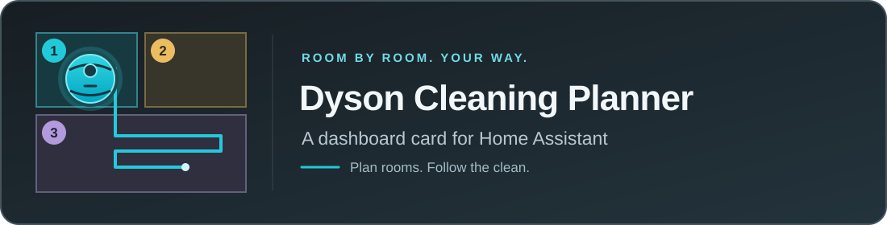
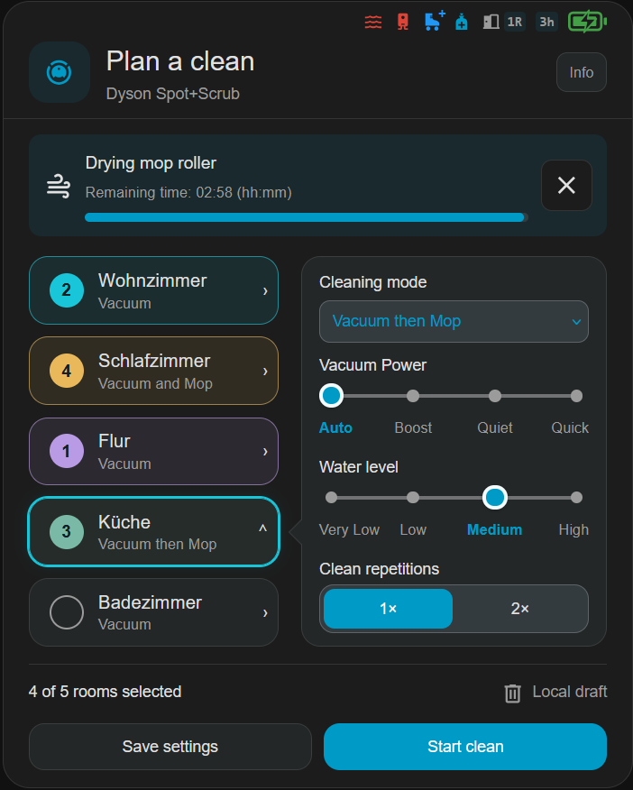
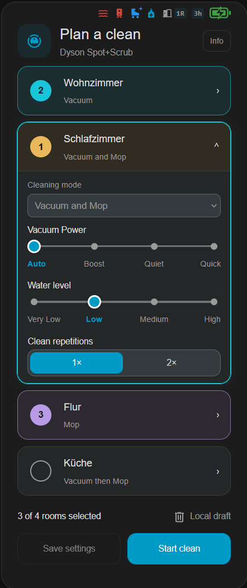
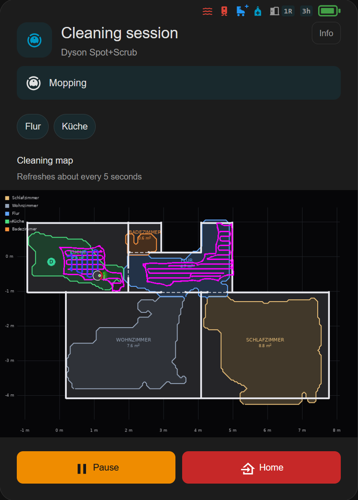
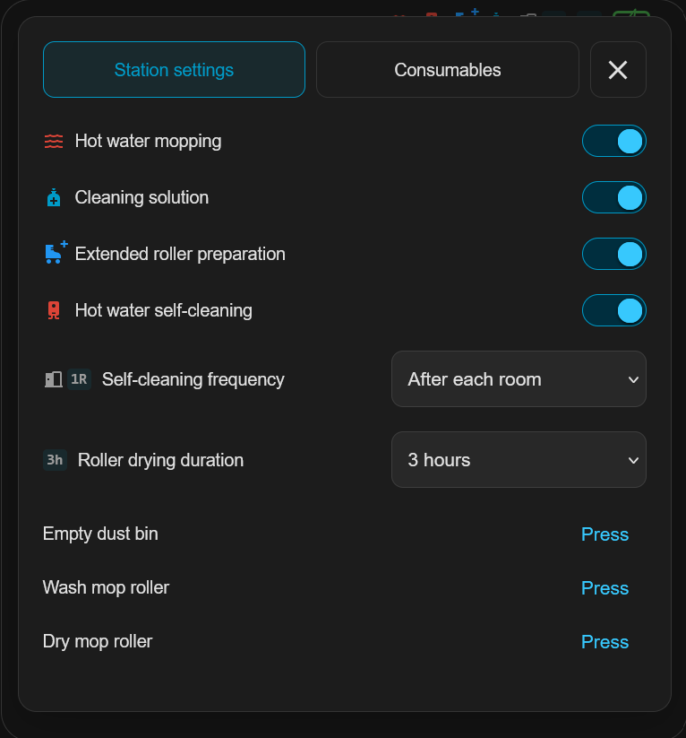
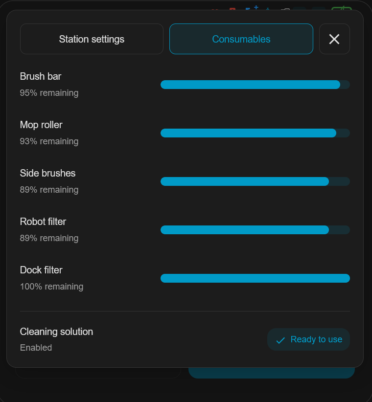

<p align="center">
  
</p>

<p align="center">
  <a href="https://my.home-assistant.io/redirect/marketplace_repository/?owner=FutuRazor&amp;repository=dyson-cleaning-planner-card&amp;category=plugin">
    
  </a>
</p>

<p align="center">
  <a href="https://github.com/FutuRazor/dyson-cleaning-planner-card/releases/latest"></a>
  <a href="https://github.com/FutuRazor/dyson-cleaning-planner-card/actions/workflows/validate.yml"></a>
  <a href="https://futurazor.github.io/dyson-cleaning-planner-card/preview/index.html"></a>
</p>

<p align="center">
  Plan room cleaning, adjust each room's settings, and follow your Dyson's progress in Home Assistant.
</p>

**Version 1.2.0**

## Requirements

- [Dyson Spot+Scrub integration by UNsync3D](https://github.com/UNsync3D/ha-dyson-spot-scrub), **v1.5.0 or newer**, installed and configured in Home Assistant.
- **Home Assistant Marketplace** for the recommended installation method on Home Assistant **2026.11 or newer**. On older versions, use [HACS](https://www.hacs.xyz/). Manual installation is also supported.

## Screenshots

<p align="center">
  
  <br>Modern planner — wide layout
</p>

<table>
  <tr>
    <td align="center"><br>Narrow layout</td>
    <td align="center"><br>Cleaning session</td>
  </tr>
  <tr>
    <td align="center"><br>Station settings</td>
    <td align="center"><br>Consumables</td>
  </tr>
</table>

[Try the interactive preview](https://futurazor.github.io/dyson-cleaning-planner-card/preview/index.html). It uses simulated data; no robot is connected.

## Installation

### Marketplace (recommended — Home Assistant 2026.11 or newer)

1. Open **Settings → Marketplace**.
2. Select **Add from link** in the upper-right corner.
3. Enter `https://github.com/FutuRazor/dyson-cleaning-planner-card` and select **Add**. If asked for the content type, choose **Dashboard**. Connect your GitHub account if prompted.
4. Open **Dyson Cleaning Planner Card** and select **Install**.
5. Reload your Home Assistant page, then add the card to your dashboard as described below.

You can install through **Add from link** even before the card is listed in the public catalog. If it is already listed, find and install it directly. See the [Marketplace instructions](https://www.home-assistant.io/integrations/marketplace) for details.

### HACS (Home Assistant versions before 2026.11)

1. Open **HACS** in Home Assistant.
2. Open the **⋮ menu → Custom repositories**.
3. Enter `https://github.com/FutuRazor/dyson-cleaning-planner-card`, select **Dashboard** as the type, and click **Add**.
4. Find **Dyson Cleaning Planner Card** in HACS, open it, and download it.
5. Reload your Home Assistant page.

If the repository is already listed in HACS, you can find and download it directly. See [HACS custom repository instructions](https://www.hacs.xyz/docs/faq/custom_repositories/) if needed.

### Manual installation

1. Download **dyson-cleaning-planner-card.js** from the [latest release](https://github.com/FutuRazor/dyson-cleaning-planner-card/releases/latest).
2. Copy **only this JavaScript file** into:

   ```text
   /config/www/dyson-planner/dyson-cleaning-planner-card.js
   ```

   Create the `www` and `dyson-planner` folders if needed. Do not copy the whole `dist` folder. When accessing the configuration folder from Windows, the relative path is `www\dyson-planner\dyson-cleaning-planner-card.js`.

3. Go to **Settings → Dashboards → ⋮ → Resources → Add resource**:
   - **URL:** `/local/dyson-planner/dyson-cleaning-planner-card.js`
   - **Resource type:** JavaScript module
4. If you created the `www` folder for the first time, restart Home Assistant. Reload the dashboard afterward.

If **Resources** is not visible, enable **Advanced mode** in your Home Assistant user profile.

### Add the card to your dashboard

Open your dashboard and choose **Edit dashboard → Add card**. Search for **Dyson Cleaning Planner**, select your Dyson vacuum, and save. Rooms and supported controls are detected automatically.

The visual editor handles the usual setup; no YAML is required.

<details>
<summary>If the card does not appear after a Marketplace or HACS installation</summary>

Reload the page first. Marketplace normally registers the dashboard resource automatically. If the card is still missing, check **Settings → Dashboards → ⋮ → Resources** for its JavaScript module:

```text
/local/community/dyson-cleaning-planner-card/dyson-cleaning-planner-card.js
```

An existing HACS installation may use `/hacsfiles/dyson-cleaning-planner-card/dyson-cleaning-planner-card.js`; that path continues to work after migration. Keep any version parameter already present in the URL. Do not add a second resource if either path is already registered.

Add the resource only if it is missing. If you manage dashboard resources in YAML, follow the installation dialog's instructions and register it in your `lovelace.resources` configuration instead.

</details>

### Updates

Update through Marketplace (or HACS on older Home Assistant versions), or replace the same JavaScript file for a manual installation. Reload the page; if the old version remains, use **Ctrl+F5** on a desktop browser or clear the frontend cache in your browser/app. You do not normally need to change the resource URL.

## Using the card

### Plan a clean

In **Modern**, tap the circle to select a room; its number shows the selection order. Tap the room name, mode or arrow to open its settings without changing the selection. **Classic** remains available in the editor.

Adjust **Cleaning mode**, **Vacuum Power**, **Water level**, and **Clean repetitions**. Power and water sliders snap to the options supplied by the integration. Settings irrelevant to the current mode are hidden by default; repetitions remain available in every mode.

Changes stay in a local draft until you choose:

- **Save settings** — save changed room settings without starting a cleaning session.
- **Start clean** — start the selected rooms with your chosen settings.

The trash icon beside **Local draft** discards unsaved changes. Reloading the card also clears the draft. Selected room IDs are sent in click order; the integration and robot execute the request. The display order configured in the editor is separate from this selection order.

### During and after cleaning

The card switches to a cleaning view with robot status, room badges when known, and an optional live map. Use **Pause**, **Resume**, or **Home** as available.

Dock activity appears below the header, including dust-bin emptying, roller washing and drying. Drying shows the remaining time and a progress bar when available, with a button to cancel it. New cleaning starts follow the integration's readiness checks; starting during drying is allowed.

### Station settings and consumables

The **Info** button opens two tabs:

- **Station settings:** hot-water options, cleaning solution, extended roller preparation, self-cleaning frequency and drying duration, plus **Empty dust bin**, **Wash mop roller** and **Dry mop roller**.
- **Consumables:** remaining life for the brush bar, mop roller, side brushes and filters, plus cleaning-solution availability and whether its use is enabled.

Controls depend on the entities and actions provided by your installed integration. Newer actions such as **Dry mop roller** require a version that provides them; unavailable controls cannot be used.

**Station settings take effect immediately** and are separate from the room draft. Consumable bars change from the theme accent to orange and red as their remaining life decreases. The Info button highlights red when a consumable needs attention.

## Customization

### Language

Choose **Automatic**, **English**, or **Deutsch** in the card editor. Automatic (the default) follows the current Home Assistant user’s language and falls back to English for unsupported languages. The card and its visual editor use the selected language.

Room and device names, custom titles, and values sent to the integration stay unchanged. Leave the title empty to use the translated default; an existing explicit title such as `Plan a clean` stays as entered. Unknown integration options and external error messages remain in their original language.

Additional languages can be added through the [translation guide](docs/translations.md).

### Appearance

Choose **Modern** (default) or **Classic** in the card editor's **Theme** setting. Modern uses numbered selection circles, discrete sliders for Vacuum Power and Water level, and buttons for Clean repetitions. At card widths of 480 px or more, the open room's settings appear beside the room list; narrower cards expand them inline. Both themes use the same local draft and send selected rooms in click order. In the wide layout, changing cleaning modes preserves the settings-panel height. Room tiles become more compact from five displayed rooms onward; exactly five rows align with the settings panel.

Open **Edit dashboard**, then edit the card to change its title, room visibility and display order, optional map and map rotation. You can also choose whether unavailable settings are hidden or disabled, and whether settings irrelevant to the selected cleaning mode remain visible.

The **status bar** shows station preferences and battery status. Disable the entire bar or hide individual indicators in the editor. Battery percentage is optional and off by default.

Interacting with **Map camera**, map visibility or rotation in the editor opens a simulated cleaning view in that preview only. Room visibility/order and room-setting display options return it to the planner. This preview sends no cleaning commands and does not switch other dashboard cards.

Where Home Assistant offers the **Layout** tab, height is automatic by default. A fixed height enables scrolling inside the card. Room edits preserve your scroll position; switching between planner and cleaning views starts at the top.

<details>
<summary>Advanced YAML options</summary>

These options belong in the individual card's code editor, not in `configuration.yaml`.

| Option | Description |
|---|---|
| `entity` | Required Dyson vacuum entity |
| `title` | Custom planner title; empty or omitted uses the translated default |
| `language` | `auto` (default), `en`, or `de`; applies to this card and its editor |
| `theme` | `modern` (default) or `classic` |
| `always_show_all_settings` | Keep all room settings visible; default: `false` |
| `unsupported_settings` | `disabled` (default) or `hidden` |
| `excluded_rooms` | Room switch entity IDs to hide |
| `room_order` | Room switch entity IDs in display order |
| `room_entities` | Optional mapping from room names to switch entity IDs |
| `show_camera` | Show the map during cleaning; default: `true` |
| `camera_entity` | Optional camera entity on the same Dyson device |
| `camera_rotation` | `0`, `90`, `180`, or `270` degrees |
| `show_status_bar` | Show station indicators and battery; default: `true` |
| `hidden_status_items` | Indicators to hide; configure through the visual editor; default: `[]` |
| `show_battery_percentage` | Show the battery percentage beside the icon; default: `false` |

</details>

## Limitations and troubleshooting

- The card relies on the integration for room data, robot status and supported actions. Room badges may show the request made from this card; they are not confirmed per-room progress.
- On upgrade, cards without an explicit `theme` use Modern. Select Classic in the editor to retain the previous layout.
- After changes to the robot's map, use **Refresh rooms** below the room order in the card editor if needed.
- If controls are unavailable, check the corresponding device and entities in Home Assistant and confirm that the required integration version is installed.


## License

[MIT](LICENSE) · Copyright (c) 2026 FutuRazor.

